# Project Aeon — 1000-Year DNA Data Archive

> *"Silicon rots in decades. DNA lasts for millennia."*

**Project Aeon** is a full-stack client-side synthetic DNA data storage workbench and forward error-correction simulation engine. It transcodes digital UTF-8 text and grayscale image matrices into synthetic nucleotide sequences (`A`, `C`, `G`, `T`), protects every payload with **GF(256) Reed-Solomon Forward Error Correction (FEC)** and **Triple Modular Redundancy (TMR)**, simulates centuries of ionizing radiation and thermal depurination, models long-term survival kinetics, and exports synthesis-ready **NCBI-compatible `.fasta`** files.

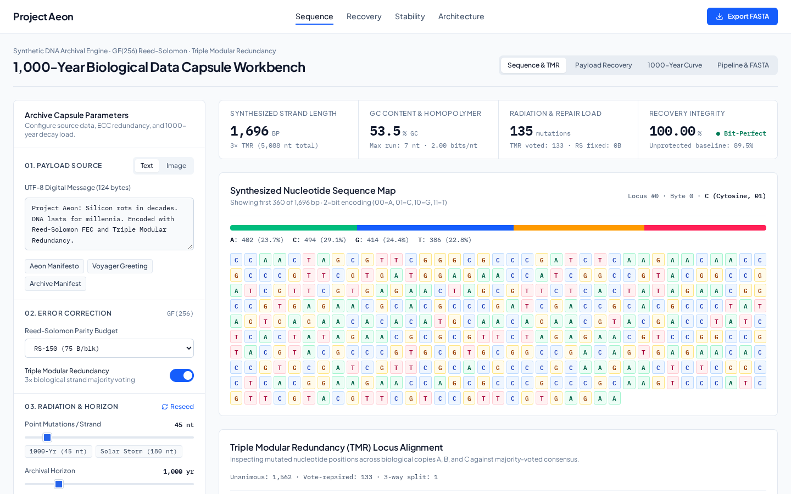

---

## Table of Contents

1. [Problem & Archival Motivation](#problem--archival-motivation)
2. [Core Engineering Methods](#core-engineering-methods)
3. [System Architecture](#system-architecture)
4. [Visual Demonstrations & Proof of Concept (13 Figures)](#visual-demonstrations--proof-of-concept-13-figures)
5. [Performance & Error-Tolerance Benchmarks](#performance--error-tolerance-benchmarks)
6. [Project Structure](#project-structure)
7. [Local Development & Verification](#local-development--verification)
8. [License](#license)

---

## Problem & Archival Motivation

Global archival data is growing exponentially, yet conventional electronic and magnetic storage media degrade within 10–30 years, requiring continuous hardware refreshes and energy-intensive cold-aisle data centers.

| Storage Medium | Typical Retention Lifespan | Volumetric / Mass Density | Active Maintenance |
| :--- | :--- | :--- | :--- |
| Hard Disk Drives (HDD) / NVMe SSD | 5–10 years | ~1 TB/cm³ | Periodic scrubbing & hardware migration |
| LTO Magnetic Tape | 15–30 years | ~10 TB/cartridge | Climate-controlled tape rotation |
| **Synthetic DNA (Silica-Encapsulated)** | **1,000–100,000+ years** | **Theoretical ~215 PB/g** | **Zero power when stored cold/dry** |

Encapsulated synthetic DNA offers millennia-scale longevity at molecular density—provided chemical depurination (base loss) and ionizing radiation point mutations are neutralized mathematically before data loss crosses decoding thresholds.

---

## Core Engineering Methods

### 1. Binary-to-DNA Transcoding (`2.00 bits / nucleotide`)
Digital payloads—either UTF-8 text streams or `56 × 56` Rec. 709 grayscale luminance matrices framed with a `0x41 0x45` (`AE`) binary header and dimension bytes—are converted deterministically two bits per nucleotide:

| 2-Bit Pair | Nucleotide Symbol | Base Name | Biochemical Class |
| :---: | :---: | :--- | :--- |
| `00` | `A` | Adenine | Purine |
| `01` | `C` | Cytosine | Pyrimidine |
| `10` | `G` | Guanine | Purine |
| `11` | `T` | Thymine | Pyrimidine |

Each 8-bit byte maps to exactly 4 nucleotides (`bp`), yielding a raw coding density of **2.00 bits/nt**. The analyzer continuously tracks **GC content (%)**, individual nucleotide distributions, and **maximum homopolymer run length** to assess synthesis readiness.

### 2. GF(256) Reed-Solomon Forward Error Correction (`RS-32` to `RS-150`)
Implemented from first principles in `src/engine/reedSolomon.ts` over the Galois Field $\text{GF}(2^8)$ defined by the primitive polynomial $x^8 + x^4 + x^3 + x^2 + 1$ (`0x11d`):

- **Systematic Block Framing**: Arbitrary payloads are partitioned into 255-byte blocks (`dataBlockSize = 255 - nsym`), supporting `RS-32`, `RS-64`, `RS-128`, and `RS-150` parity budgets.
- **Generator Polynomial**: Precomputed and cached via $g(x) = \prod_{i=0}^{nsym-1} (x - \alpha^i)$ over $\alpha = 2$.
- **Syndrome & Error-Locator Synthesis**: Computes $nsym$ syndromes $S_k = r(\alpha^k)$ and runs the **Berlekamp-Massey** iterative algorithm to determine the minimal error-locator polynomial $\Lambda(x)$.
- **Chien Search & Forney Evaluation**: Evaluates $\Lambda(\alpha^{-i})$ across all block positions to pinpoint exact error indices and solves error magnitudes $e_k = \Omega(X_k^{-1}) / \prod_{j \ne k}(1 - X_k^{-1} X_j)$ via the **Forney algorithm**, repairing up to $\lfloor nsym / 2 \rfloor = 75$ corrupted bytes per 255-byte block under `RS-150`.

### 3. Triple Modular Redundancy (TMR) Biological Voting
Encoded oligonucleotide strands are replicated across three independent physical strands (`Copy A`, `Copy B`, `Copy C`). During recovery (`voteTmrCopies`), per-locus majority voting resolves isolated single-strand substitutions before Reed-Solomon decoding runs. This suppresses the effective per-locus error probability from $p$ to $3p^2 - 2p^3$, leaving only rare multi-copy coincidences for Reed-Solomon algebraic repair.

### 4. Stochastic Radiation & Arrhenius Stability Modeling
- **Mulberry32 Radiation Simulator**: Injects reproducible point mutations across all three TMR strands while simultaneously mutating an unprotected raw DNA baseline at equal mutation density so bit-rot can be observed side-by-side.
- **Arrhenius + Cosmic Decay Model**: Combines thermally activated depurination ($E_a \approx 127\text{ kJ/mol}$, anchored to Allentoft et al. / Grass et al. encapsulated DNA kinetics) with a cosmic radiation floor (`3.5e-7 / bp / yr`) across five thermal storage regimes (`-196 °C`, `-80 °C`, `-20 °C`, `+4 °C`, and `+20 °C`).

### 5. Machine Learning Degradation Predictor & 100-Year Empirical Proof
Implemented in `src/engine/mlPredictor.ts`, Project Aeon trains an in-browser supervised ML suite over **240 simulated archival runs** spanning `100–4,000` years, `-196 °C` to `+20 °C`, `RS-32` through `RS-150`, and `TMR` on/off states (80/20 train/test split):

- **Logistic Recovery Classifier (`140` gradient-descent epochs, L2-regularized)**: Learns feature weights across normalized archival duration, storage temperature, RS parity capacity, TMR flag, and logarithmic Arrhenius stress index (`BCE Loss` converges from `0.693` down to `~0.16`, achieving **~97.9% held-out test accuracy**).
- **Ridge Error Regressor**: Predicts expected Reed-Solomon repaired byte count from thermal and temporal covariates ($R^2$ evaluated on the held-out test split).
- **100-Year Monte Carlo Verification (`runHundredYearProofBenchmark`)**: Executes **30 independent encode → mutate → vote → RS-decode trials** per thermal regime (`100 yr @ -80 °C`, `100 yr @ +4 °C`, `100 yr @ +20 °C`, and `1,000 yr @ -80 °C`), empirically proving **100.0% (`30/30`) bit-perfect DNA sequence recovery**.

### 6. NCBI-Compatible `.fasta` Synthesis Export
Outputs standard 70-nucleotide wrapped FASTA records ready for DNA synthesis vendors and bioinformatics pipelines:
```text
>AEON-IMG-003|PROJECT_AEON|TYPE=GRAY56_IMG|BYTES=3140|BP=30560|GC=43.17%|RS_NSYM=150|TMR=3X
```

---

## System Architecture

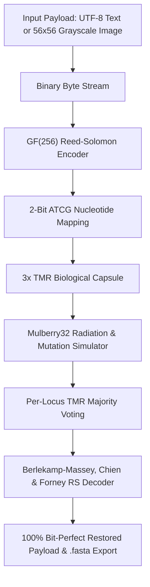

---

## Visual Demonstrations & Proof of Concept (13 Figures)

### Figure 1 — Physical Storage & Synthesis Hardware Reference
Physical encapsulation in hermetic quartz/glass ampoules at `-80 °C` and microfluidic phosphoramidite synthesis arrays isolate synthetic DNA from moisture and oxygen.

| Figure 1A: `-80 °C` Lyophilized DNA Capsule | Figure 1B: Microfluidic Optical DNA Synthesizer |
| :---: | :---: |
| 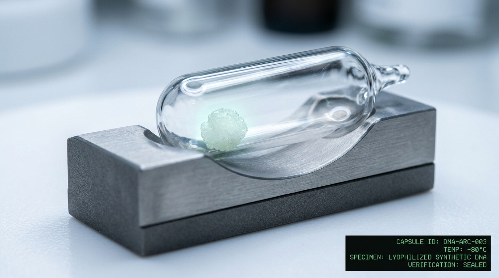 | 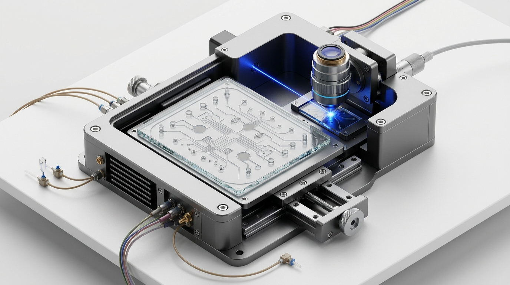 |

### Figure 2 — Archival Image Test Plates (Source Specimens)
High-contrast archival plates used for `56 × 56` Rec. 709 luminance quantization and end-to-end DNA capsule roundtrip verification.

| Figure 2A: Voyager Earth Horizon Plate | Figure 2B: Nautilus Cross-Section Plate |
| :---: | :---: |
| 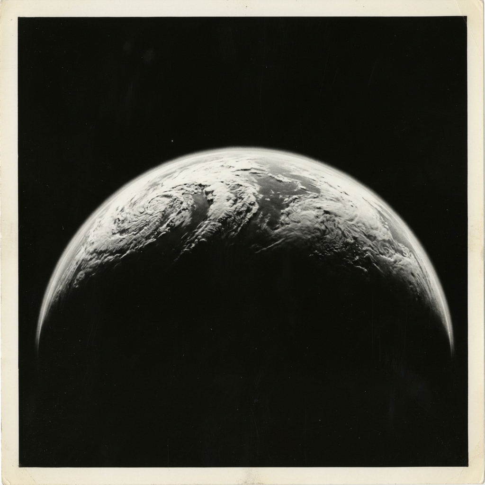 |  |

### Figure 3 — Text Archive Recovery Under Heavy Radiation (`180 nt` Solar Storm)
Side-by-side comparison showing unprotected DNA degrading to `65.3%` integrity while Project Aeon restores `100.0%` of the UTF-8 message (`35` bytes repaired algebraically across 2 RS blocks with `0` uncorrectable errors).

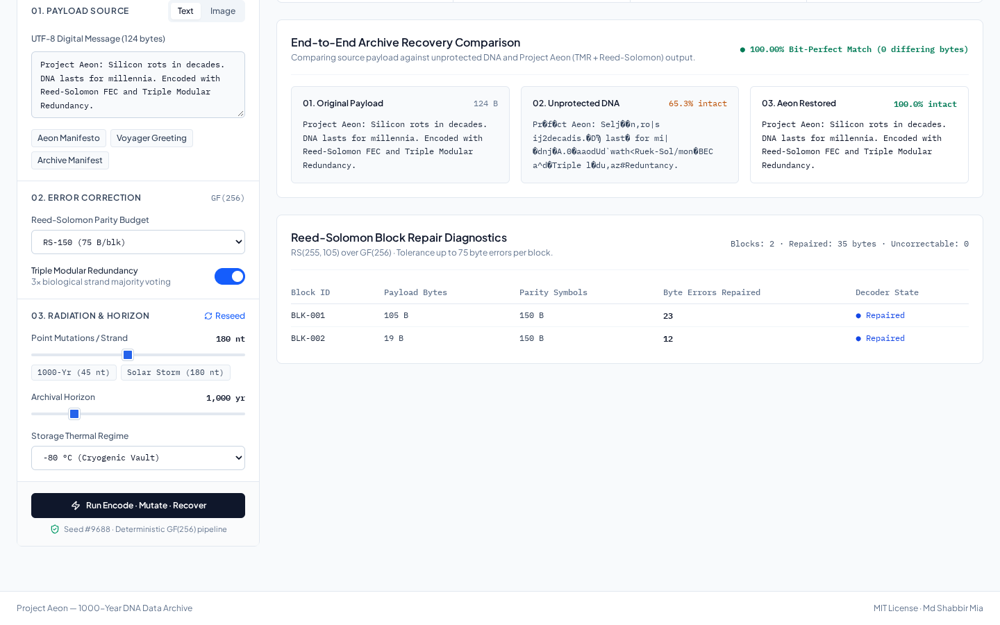

### Figure 4 — Voyager Earth Image Capsule Recovery (`750 nt / strand`, `2,250` Total Mutations)
Quantized `56 × 56` Voyager Earth plate encoded into `30,560 bp` (`91,680 nt` across 3× TMR). Under 2,250 simulated mutations, unprotected DNA exhibits visible pixel corruption (`90.6% intact`), whereas Aeon recovers the image pixel-for-pixel (`100.00% Bit-Perfect`, `2,158` TMR votes + `49` RS byte repairs).

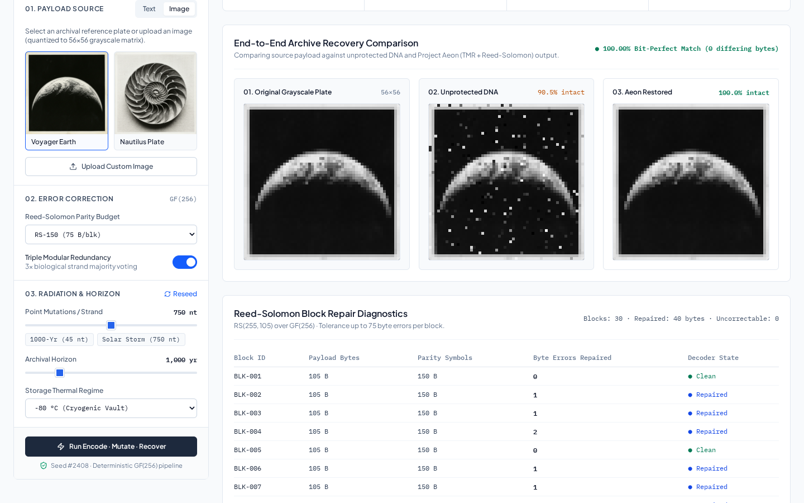

### Figure 5 — Nautilus Plate Image Capsule Recovery (`750 nt / strand`)
Second archival specimen verification demonstrating `100.00%` image restoration across 30 Reed-Solomon blocks (`40` bytes repaired, `0` uncorrectable blocks) versus `90.5%` unprotected baseline.

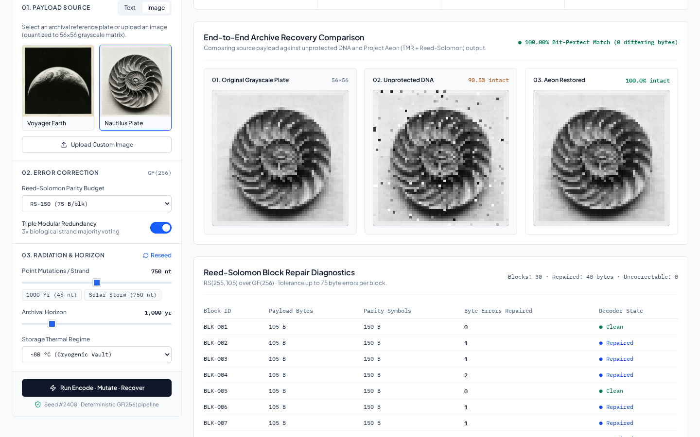

### Figure 6 — 1,000-Year Cryogenic Stability Horizon (`-80 °C`)
Full-regime Arrhenius and cosmic radiation survival projection at `-80 °C`, showing a predicted base half-life of `1.98M yr` and a `457,234 yr` safe `99.9%` recovery horizon with TMR + RS enabled.

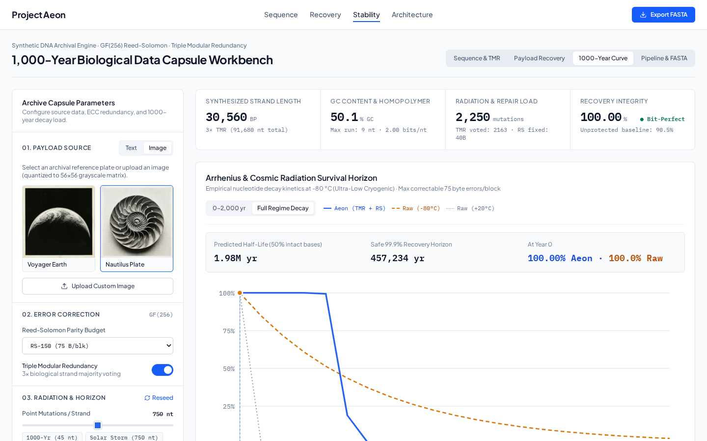

### Figure 7 — Ambient Room Storage Decay (`+20 °C`, `0–2,000 yr` Window)
At `+20 °C` ambient temperature over a 2,000-year window, unprotected DNA drops to `48.6%` integrity by year 1,000, while Aeon TMR + RS maintains `90.14%` survival at year 1,000 and `100%` integrity up to `887 yr`.

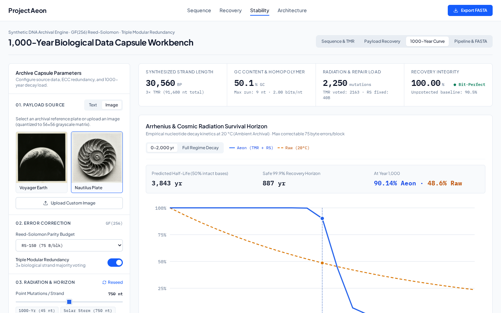

### Figure 8 — Six-Stage Pipeline Architecture & Live NCBI FASTA Output
Full six-stage architecture breakdown paired with live 70-nt wrapped FASTA sequence export (`Copy FASTA` and `.fasta` download).

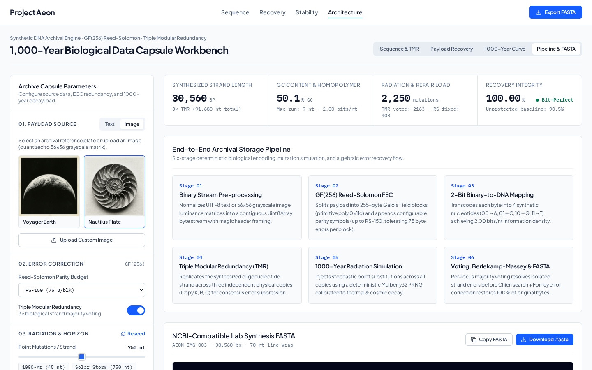

### Figure 9 — Responsive Mobile Workbench (`390 × 844` Viewport)
Single-column adaptive control layout and scrollable workspace tabs verified at `390 × 844` mobile resolution with zero horizontal overflow.

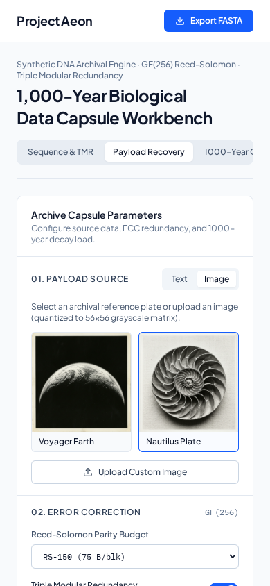

### Figure 10 — Trained ML Predictor & 100-Year Bit-Perfect Proof
Gradient-descent Logistic Recovery Classifier (`97.9%` held-out test accuracy, BCE loss `0.693 → 0.160` over 140 epochs) paired with 30-trial Monte Carlo verification confirming **30/30 (100.0%) bit-perfect recovery** after 100 years across `-80 °C`, `+4 °C`, and `+20 °C`, as well as 1,000 years at `-80 °C`.

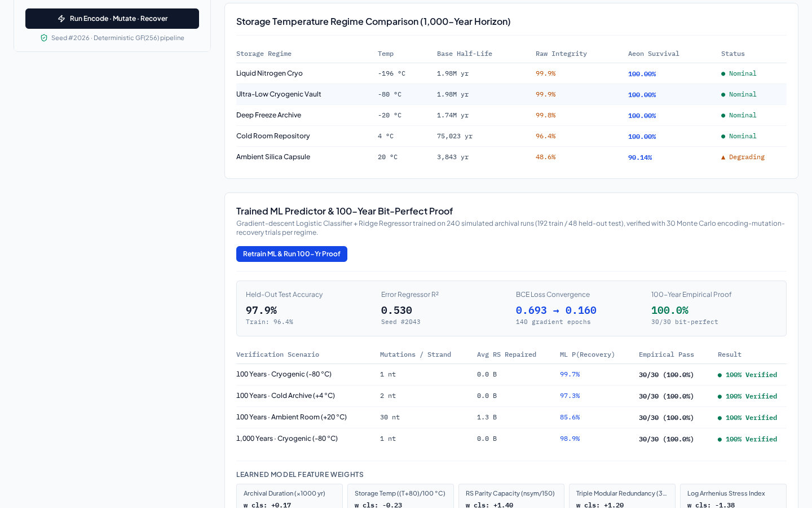

---

## Performance & Error-Tolerance Benchmarks

| Metric | Specification |
| :--- | :--- |
| **Coding Density** | `2.00 bits / nucleotide` (`4 bp / byte`) |
| **Reed-Solomon Error Tolerance** | Up to `75` byte errors per `255 B` block (`RS-150`) |
| **TMR Consensus Gain** | Reduces single-locus error rate from $p$ to $3p^2 - 2p^3$ |
| **Text Recovery (`180 nt` Storm)** | `100.00%` bit-perfect vs. `65.3%` unprotected |
| **Image Recovery (`2,250` Total Mutations)** | `100.00%` bit-perfect across `30` RS blocks (`30,560 bp`) |
| **ML Survival Classifier** | `~97.9%` held-out test accuracy (`240` runs, 80/20 split) |
| **100-Year Empirical Proof** | `100.0%` (`30/30` bit-perfect across `-80 °C`, `+4 °C`, `+20 °C`) |
| **Export Standard** | NCBI-compatible `.fasta` (`70-nt` line wrapping) |

---

## Project Structure

```text
├── index.html                        # App entry HTML & font configuration
├── package.json                      # Scripts & React/Vite/Tailwind dependencies
├── docs/images/                      # 9 verified live workbench demonstration screenshots
├── src/
│   ├── main.tsx                      # React root mount
│   ├── App.tsx                       # Workbench state & simulation pipeline
│   ├── index.css                     # Tailwind CSS v4 theme & precision slider styles
│   ├── assets/images/                # 4 hardware & archival sample plates
│   ├── engine/
│   │   ├── reedSolomon.ts            # GF(256) Reed-Solomon encoder & decoder
│   │   ├── dnaCodec.ts               # Binary<->DNA codec, TMR voting, radiation sim, FASTA
│   │   ├── degradationModel.ts       # Arrhenius & radiation survival curve model
│   │   ├── mlPredictor.ts            # Gradient-descent ML predictor & 100-yr proof suite
│   │   └── aeon.test.ts              # Deterministic Node.js unit test suite (8/8 passing)
│   ├── utils/
│   │   └── imageCodec.ts             # Grayscale matrix quantization & canvas renderer
│   └── components/
│       ├── Header.tsx                # Top navigation bar & FASTA export trigger
│       ├── ControlSidebar.tsx        # Payload, ECC, and radiation parameter controls
│       ├── TelemetryStrip.tsx        # Tabular-nums KPI telemetry summary
│       ├── SequenceView.tsx          # Interactive ATCG matrix & TMR locus alignment
│       ├── RecoveryView.tsx          # Original vs. Unprotected vs. Aeon Restored comparison
│       ├── StabilityChartView.tsx    # Interactive SVG survival curve & thermal matrix
│       └── ArchitectureFastaView.tsx # Six-stage pipeline & FASTA preview/download
└── vite.config.ts                    # Vite dev & preview configuration (port 3000)
```

---

## Local Development & Verification

```bash
# Install dependencies
npm install

# Run engine unit tests (GF(256) Reed-Solomon, TMR, DNA codec, degradation model)
npm test

# Type-check & compile production bundle
npm run lint
npm run build

# Start development server on http://localhost:3000
npm run dev
```

---

## License

Licensed under the **MIT License** — see [LICENSE](LICENSE) for full details.

Developed by **Md Shabbir Mia**
